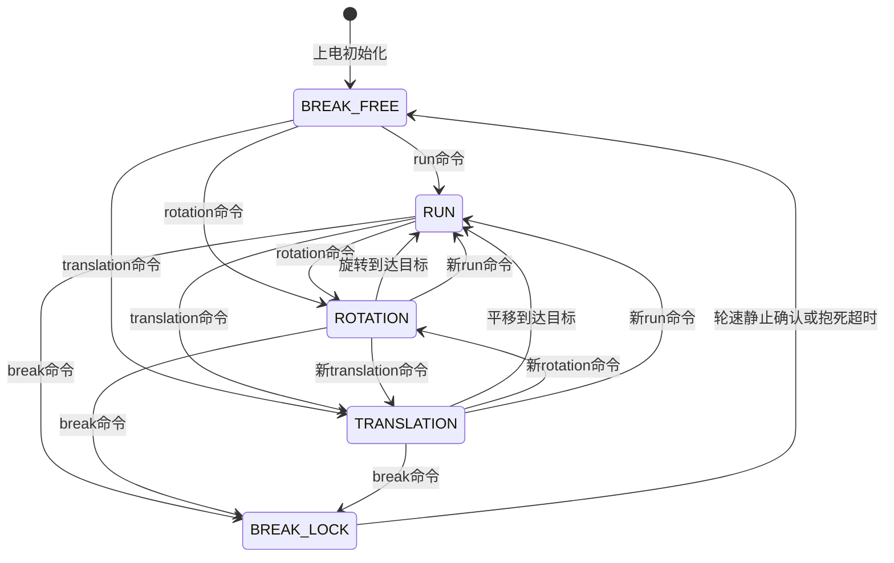

# 底盘运动状态机设计说明

本文档只整理底盘运动控制的设计思路，不修改现有代码。目标是后续实现时让 `break`、`run`、`rotation`、`translation` 四种运动之间的衔接更稳定，尤其补完整定点平移运动，并避免模式切换时因为角度目标、速度目标、PID 输出残留导致车辆突然抽动、反打或来回振荡。

## 1. 当前代码中的状态和核心变量

当前底盘运动入口主要在 `Code/ChaseNum1_Movement.c`：

- `Whole_Movement_Type`：当前运动模式，对应 `Movement_Breaking`、`Movement_Running`、`Movement_Rotation`、`Movement_Translation`。
- `Whole_Movement`：当前运动命令参数，目前在 `CN_set_movement()` 中没有完整保存，后续建议保存下来用于状态维护和回包。
- `YAW_now`：IMU 当前车身角度。
- `YAW_aim`：车身角度闭环目标。
- `YAW_acc`：run 模式下用于连续积分角度目标的角速度命令。
- `target_anv`：角速度闭环目标。
- `target_VelX` / `target_VelY`：车身速度目标。
- `target_yaw`、`YAW_inital`、`YAW_gain`、`YAW_pre`：rotation 模式中用于任意角度旋转的累计角度变量。
- `distance_to_go`、`target_pose`、`start_pose`、`cur_x`、`cur_y`：translation 模式准备使用的位置变量。
- `Vel_aim` / `Vel_now`：四轮速度目标和当前编码器增量速度。
- `Duty_now`：四轮 PWM 输出累计值。
- `Car_yaw_PID_ctrler`：车身角度环。
- `Car_anv_PID_ctrler`：车身角速度环。
- `FL/FR/BL/BR_vel_PID_ctrler`：四个轮子的速度环。
- `Car_yaw_moving_PID_ctrler`：目前用于 translation 模式的姿态修正 PID，但位置环主体基本仍是注释状态。

当前运动层的基本调用链是：

```text
上位机/协议层
  -> CN_set_movement(movement, movement_type)
      -> 设置模式、设置目标、部分 PID 清零

定时器周期回调
  -> CN_Movement_ctrl_CALLBACK(ms)
      -> 根据 Whole_Movement_Type 调用角度环、角速度环、速度环、位置环
```

## 2. 当前状态机的主要风险点

### 2.1 模式切换时统一清 PID 过于粗糙

当前 `CN_set_movement()` 中只要 `Whole_Movement_Type != movement_type`，就会统一清空：

```c
PID_ctrler_reset(&Car_yaw_moving_PID_ctrler);
PID_ctrler_reset(&Car_anv_PID_ctrler);
PID_ctrler_reset(&Car_yaw_PID_ctrler);
```

这个动作简单，但会带来两个问题：

- 从 run 切到 rotation 或 translation 时，姿态环输出被突然清零，短时间内车身姿态闭环可能断一下。
- 从 rotation / translation 自动回到 run 时，如果 `YAW_aim`、`target_anv`、`target_VelX/Y` 没有按真实状态重新接上，车辆可能突然补偿一个旧误差。

后续建议：不要在所有模式切换时统一粗暴清空所有 PID，而是在每个状态的“入口动作”里有选择地重置。只有目标发生不连续变化的环才清空，目标连续的环尽量保留或平滑过渡。

### 2.2 break 不是单一瞬间动作，而应该拆成两个阶段

当前 break 已经有闭环刹车思路：先把四轮目标速度压到 0，保持当前车身朝向，等轮速足够小或超时后再放开控制。

这个方向是对的，但从状态机角度看，`Movement_Breaking` 不能只理解为“停 PWM”。它至少包含两个子阶段：

```text
BRAKE_LOCK：闭环抱死轮子，车身目标速度为 0，保持当前姿态
BRAKE_FREE：确认静止后放开控制，PWM 输出为 0
```

如果不区分这两个阶段，就容易出现：

- 从高速 run 进入 break 时直接放开控制，车会因为惯性滑很远。
- break 放开后车辆被人为转动，再进入 run 时如果沿用旧 `YAW_aim`，车会突然转回旧方向。
- break 期间收到新的运动命令时，如果没有重新初始化角度基准和速度环，可能出现突然抽动。

### 2.3 rotation 到 run 的角度连续性需要明确

当前 rotation 使用 `YAW_gain` 记录累计旋转角度，可以支持超过 180 度的任意角度旋转，这是正确方向。

但当前有几个隐患：

- 接近目标时直接设置 `CN_CAR_anv_CL_set_aim(0.3)`，没有考虑目标正负方向，负向旋转接近终点时可能方向不对。
- 到达目标后切到 run，构造的 `TempMovement` 全为 0，但没有明确 run 的 `YAW_aim` 应该保持最终角度还是当前角度。
- `YAW_aim = YAW_now` 在 rotation 循环里持续覆盖，会让进入 run 后到底保持哪个角度不够清晰。

后续建议：rotation 状态到达目标时，进入“零速度 run”，并把 `YAW_aim` 明确设置为最终目标角度或当前实际角度。为了衔接稳定，建议如下：

- 如果最终角度误差在允许范围内：`YAW_aim = 目标最终角度`，让 run 状态继续轻微保持。
- 如果因为外力或打滑导致误差较大：`YAW_aim = YAW_now`，避免切换瞬间猛拉回去。

### 2.4 translation 当前没有真正实现

当前 `CN_CAR_pos_CL_set_aim()` 和 `CN_CAR_pos_CL_CALLBACK()` 的核心逻辑几乎都被注释掉，因此 `Movement_Translation` 目前不能可靠完成“相对当前位置定点定向定速平移”。

后续需要把 translation 设计成一个独立状态，而不是简单套一个位置 PID。它应该：

- 进入状态时记录起点和车身姿态。
- 在运动过程中保持姿态闭环。
- 根据编码器增量估算相对位移。
- 沿目标直线方向平滑加速、匀速、减速。
- 到达目标后自动进入 run 状态。
- 进入 run 后目标速度为 0，但仍保持闭环姿态，除非收到 break 才放开控制。

## 3. 推荐状态机总览

建议仍保留对外的四个主状态：

```c
Movement_Breaking
Movement_Running
Movement_Rotation
Movement_Translation
```

但内部增加更明确的运行阶段变量，例如：

```c
typedef enum {
    CHASSIS_PHASE_IDLE = 0,
    CHASSIS_PHASE_BRAKE_LOCK,
    CHASSIS_PHASE_BRAKE_FREE,
    CHASSIS_PHASE_RUN_ACTIVE,
    CHASSIS_PHASE_ROTATION_ACTIVE,
    CHASSIS_PHASE_TRANSLATION_ACTIVE,
    CHASSIS_PHASE_FINISH_TO_RUN
} Chassis_Phase_Enum;
```

主状态用于对外协议和上位机理解，内部阶段用于处理模式衔接。

推荐状态关系如下：



核心原则：

- 只有收到 break 命令，才进入 `Movement_Breaking`。
- run、rotation、translation 都保持底盘闭环。
- rotation 到达目标后自动进入 run。
- translation 到达目标后自动进入 run。
- break 先进入闭环抱死，再进入放开控制。
- 从 break 退出到任意运动模式时，必须以当前真实姿态和零速度为起点重新初始化，不能沿用 break 之前的逻辑目标。

## 4. 各状态功能设计

### 4.1 Movement_Breaking：停车并最终放开控制

break 状态建议拆成两个阶段。

#### 4.1.1 BRAKE_LOCK：闭环抱死阶段

进入条件：

- 上位机发送 break 命令。
- 任意状态下 break 都最高优先级立即生效。

入口动作：

- 保存当前实际姿态：`brake_yaw_hold = YAW_now`。
- 设置 `YAW_aim = brake_yaw_hold`。
- 设置 `target_VelX = 0`，`target_VelY = 0`。
- 设置 `YAW_acc = 0`，`target_anv = 0`。
- 清空角速度环 PID：`Car_anv_PID_ctrler`。
- 清空四轮速度环 PID：`FL/FR/BL/BR_vel_PID_ctrler`。
- 清空四轮目标速度：`Vel_aim = 0`。
- 不要立即关 PWM，而是让速度环继续执行，把轮速压到 0。
- 清空 break 计时器：`brake_elapsed_ms = 0`，`brake_still_ms = 0`。

周期动作：

- 姿态环仍然运行，使车身不乱转：

```text
YAW_aim = brake_yaw_hold
角度环 -> 角速度目标
角速度环 -> 旋转修正输出
速度环 -> 四轮目标速度为 0 + 姿态修正
```

- 速度环持续把四轮速度目标压到 0。
- 检查四轮实际速度绝对值最大值：

```text
max_abs_wheel_vel = max(abs(FL), abs(FR), abs(BL), abs(BR))
```

- 如果连续一段时间小于静止阈值，认为车身已经停稳。
- 如果超过最大抱死时间，也退出抱死，避免长时间堵转。

退出条件：

- `max_abs_wheel_vel <= CHASSIS_BRAKE_STILL_VEL_EPS` 连续达到 `CHASSIS_BRAKE_STILL_CONFIRM_MS`。
- 或者 `brake_elapsed_ms >= CHASSIS_BRAKE_MAX_HOLD_MS`。

退出动作：

- 设置四轮 PWM 为 0。
- 清空四轮 PID 和角速度 PID。
- 进入 `BRAKE_FREE`。
- 保持 `Whole_Movement_Type = Movement_Breaking`，因为对外仍然处于 break 状态。

#### 4.1.2 BRAKE_FREE：放开控制阶段

功能：

- PWM 输出为 0。
- 不执行速度闭环。
- 不执行姿态闭环。
- 允许车辆被人为推动或转动。

重要细节：

- 在 `BRAKE_FREE` 中，应该持续让 `YAW_aim = YAW_now`，或者在收到新运动命令时再设置 `YAW_aim = YAW_now`。
- 这样车辆被人为转动之后，再进入 run 不会猛地转回 break 前的旧角度。

从 break 退出到其他模式：

- 收到 run / rotation / translation 命令后，立即取消 break 阶段。
- 以当前 `YAW_now` 作为新的姿态基准。
- 四轮 PID 清零，`Duty_now` 从 0 开始。
- 速度指令从 0 平滑爬升到目标值。

### 4.2 Movement_Running：正常循迹和全向平移

run 是底盘的默认闭环工作状态。它不应该是“放开控制”，而应该始终保持：

- 车身速度闭环。
- 车身角速度闭环。
- 车身姿态闭环。

入口动作：

- 如果从 break 进入 run：
  - 设置 `YAW_aim = YAW_now`。
  - 清空角速度环和四轮速度环 PID。
  - 速度目标从 0 开始平滑变化。
- 如果从 rotation 完成进入 run：
  - `YAW_aim` 设置为 rotation 的目标最终角度，或者误差较大时设置为 `YAW_now`。
  - `target_VelX = 0`，`target_VelY = 0`，`YAW_acc = 0`。
  - 进入零速度姿态保持。
- 如果从 translation 完成进入 run：
  - `YAW_aim` 保持 translation 的姿态目标。
  - `target_VelX = 0`，`target_VelY = 0`，`YAW_acc = 0`。
  - 进入零速度姿态保持。
- 如果是普通 run 命令刷新：
  - 更新 `target_VelX`、`target_VelY`、`YAW_acc`。
  - 不必清空所有 PID，避免频繁指令导致闭环断续。

周期动作：

- 如果 `YAW_acc != 0`，按周期积分姿态目标：

```text
YAW_aim = CN_yaw_add(YAW_aim, YAW_acc * dt)
```

- 执行角度环：

```text
YAW_err = CN_get_relative_angle(YAW_now, YAW_aim)
Car_yaw_PID -> target_anv
```

- 执行角速度环：

```text
anv_err = target_anv - IMU_data.G_Z
Car_anv_PID -> rotation_correction
```

- 执行速度环：

```text
FL = target_VelY + target_VelX + rotation_correction
FR = target_VelY - target_VelX - rotation_correction
BL = target_VelY - target_VelX + rotation_correction
BR = target_VelY + target_VelX - rotation_correction
```

平滑建议：

- 上位机给出的 `Car_X_vel`、`Car_Y_vel`、`Car_angvel` 不要直接作为控制目标跳变。
- 增加内部斜坡变量，例如：

```text
cmd_vx_target：上位机目标
cmd_vx_ref：实际送入速度环的平滑目标
```

- 每个控制周期限制 `cmd_vx_ref` 向 `cmd_vx_target` 的变化量。
- `vy` 和 `wz` 同理。

这样 run 到 rotation、run 到 translation、break 到 run 都不会出现目标速度突变。

### 4.3 Movement_Rotation：任意角度旋转

rotation 的功能是原地旋转指定相对角度，完成后自动进入 run。

建议输入含义：

- `Car_angle`：相对当前角度的目标旋转角度，单位 deg，可正可负，可超过 180 度。
- `Car_angvel`：最大旋转角速度，取绝对值后由目标方向决定符号。

入口动作：

- `rotation_start_yaw = YAW_now`。
- `rotation_target_delta = Car_angle`。
- `rotation_target_abs = CN_yaw_add(rotation_start_yaw, Car_angle)`，用于完成后姿态保持。
- `YAW_gain = 0`。
- `YAW_pre = YAW_now`。
- `target_VelX = 0`，`target_VelY = 0`。
- 清空角速度 PID 和四轮速度 PID。
- 不建议直接清空角度 PID，除非 `YAW_aim` 发生明显不连续。

周期动作：

1. 计算本周期实际旋转增量：

```text
YawDelta = YAW_now - YAW_pre
如果 YawDelta > 180，则 YawDelta -= 360
如果 YawDelta < -180，则 YawDelta += 360
YAW_gain += YawDelta
YAW_pre = YAW_now
```

2. 计算剩余角度：

```text
remaining = rotation_target_delta - YAW_gain
```

3. 根据剩余角度规划角速度：

```text
direction = sign(remaining)
w_cmd = direction * min(max_w, sqrt(2 * yaw_acc_limit * abs(remaining)))
```

实际实现可以先做得简单一些：

```text
如果 abs(remaining) > slow_angle:
    target_anv = sign(remaining) * max_w
否则:
    target_anv = sign(remaining) * max_w * abs(remaining) / slow_angle
```

注意：接近目标时不能固定写 `+0.3`，必须保留目标方向。

4. 保持平移速度为 0：

```text
target_VelX = 0
target_VelY = 0
```

5. 执行角速度环和四轮速度环。

到达判定：

建议同时满足：

- `abs(remaining) <= ROTATION_ANGLE_TOL_DEG`
- `abs(IMU_data.G_Z) <= ROTATION_ANGVEL_TOL`

不要只看角度误差，否则车辆仍有角速度时切 run，会因为惯性继续冲过目标。

退出到 run：

- 设置 run 零速度：

```text
target_VelX = 0
target_VelY = 0
YAW_acc = 0
target_anv = 0
```

- 如果最终角度误差小：

```text
YAW_aim = rotation_target_abs
```

- 如果最终角度误差明显大：

```text
YAW_aim = YAW_now
```

- 清空 rotation 内部累计变量。
- `Whole_Movement_Type = Movement_Running`。

### 4.4 Movement_Translation：相对当前位置定点定向定速平移

translation 的目标是：从当前点出发，保持车身姿态不变，沿直线平移到相对目标点位，完成后自动进入 run。

建议输入含义：

- `Car_X_movement`：目标相对位移 X，单位与当前工程速度单位保持一致。正方向为车身右侧。
- `Car_Y_movement`：目标相对位移 Y，正方向为车头方向。
- `Car_rotation_vel`：平移最大合速度。虽然名字里有 rotation，但当前结构中它适合复用为 translation 的定速参数。
- `Car_angle`：translation 中建议暂时不用，或保留为未来“到达时目标姿态”。当前需求是保持车身姿态，所以入口时锁定 `YAW_now` 即可。

入口动作：

- `translation_yaw_hold = YAW_now`。
- `YAW_aim = translation_yaw_hold`。
- 清空 translation 相对里程：

```text
cur_x = 0
cur_y = 0
```

- 保存目标：

```text
target_pose.x = Car_X_movement
target_pose.y = Car_Y_movement
```

- 计算目标距离：

```text
target_distance = sqrt(x*x + y*y)
distance_to_go = target_distance
```

- 如果目标距离小于很小阈值，直接进入 run 零速度。
- 计算直线方向单位向量：

```text
ux = target_x / target_distance
uy = target_y / target_distance
```

- 清空或重置用于 translation 的速度参考：

```text
translation_speed_ref = 0
```

- 清空角速度 PID 和四轮速度 PID。

周期动作：

1. 读取本周期四轮编码器增量，估算相对位移。

当前速度环里 `Vel_now` 实际来自 `ENC_data` 的周期增量，因此 translation 可以按同样的轮子组合积分：

```text
delta_x = (FL - FR - BL + BR) / 4 / M_TO_ENC_FACTOR
delta_y = (FL + FR + BL + BR) / 4 / M_TO_ENC_FACTOR
cur_x += delta_x
cur_y += delta_y
```

这里的 `FL/FR/BL/BR` 要使用与 `CN_CAR_vel_CL_CALLBACK()` 中一致的轮子符号和映射。不要重新猜一套轮子顺序，否则会出现目标方向和实际方向不一致。

2. 计算当前沿目标直线方向的投影进度：

```text
progress = cur_x * ux + cur_y * uy
remaining = target_distance - progress
```

3. 计算横向偏差：

```text
cross_error = -cur_x * uy + cur_y * ux
```

`cross_error` 表示车辆偏离目标直线的程度。为了简单可用，可以只做一个很小的 P 修正，不用复杂路径规划。

4. 速度规划。

为了“定速但不振荡”，建议使用“中段定速，末段减速”的一维速度规划：

```text
v_max = abs(Car_rotation_vel)
v_stop_limit = sqrt(2 * TRANSLATION_DECEL * max(remaining, 0))
v_cmd = min(v_max, v_stop_limit)
```

如果先不想用 `sqrtf`，也可以用线性减速：

```text
如果 remaining > slow_distance:
    v_cmd = v_max
否则:
    v_cmd = v_max * remaining / slow_distance
```

再加一个每周期最大变化量限制：

```text
translation_speed_ref 向 v_cmd 逐步逼近
```

这样车不会一开始猛冲，也不会到目标点后因为速度太大来回振荡。

5. 合成平移速度。

沿目标方向速度：

```text
vx_line = translation_speed_ref * ux
vy_line = translation_speed_ref * uy
```

横向纠偏速度：

```text
vx_cross = -TRANSLATION_CROSS_KP * cross_error * uy
vy_cross =  TRANSLATION_CROSS_KP * cross_error * ux
```

最终目标速度：

```text
target_VelX = vx_line + vx_cross
target_VelY = vy_line + vy_cross
```

纠偏速度要限幅，避免横向误差噪声导致抖动。

6. 姿态保持。

translation 中始终保持：

```text
YAW_aim = translation_yaw_hold
YAW_acc = 0
```

然后执行：

```text
角度环 -> 角速度目标
角速度环 -> rotation_correction
速度环 -> 四轮速度目标
```

到达判定：

建议不要只判断 `distance_to_go < 某个值`。更稳的判定是：

- `remaining <= TRANSLATION_POS_TOL`
- `abs(cross_error) <= TRANSLATION_CROSS_TOL`
- 四轮速度都小于静止阈值，或 `translation_speed_ref` 已经很小

示例：

```text
if remaining <= pos_tol
   and abs(cross_error) <= cross_tol
   and max_abs_wheel_vel <= wheel_vel_tol:
       translation完成
```

如果不想等轮速，也至少要在进入 run 前把目标速度斜坡降到 0，否则切 run 会有速度目标突变。

退出到 run：

- `target_VelX = 0`
- `target_VelY = 0`
- `YAW_acc = 0`
- `target_anv = 0`
- `YAW_aim = translation_yaw_hold`
- `Whole_Movement_Type = Movement_Running`

这样 translation 到达后车辆不会放开控制，而是停在原地并保持姿态。

## 5. 模式转换的变量连续性设计

### 5.1 角度连续性

所有状态都应该遵守：

- 角度差用 `CN_get_relative_angle(now, aim)`。
- 角度累加用 `CN_yaw_add(now, delta)`。
- 任意角度旋转不要直接用 `YAW_now` 和目标绝对角相减判断完成，而要用 `YAW_gain` 累计跨越角度。

不同状态的 `YAW_aim` 处理建议：

| 转换 | `YAW_aim` 处理 |
|---|---|
| break 进入 BRAKE_LOCK | `YAW_aim = YAW_now` |
| BRAKE_FREE 进入 run | `YAW_aim = YAW_now` |
| run 进入 rotation | 记录 `rotation_start_yaw = YAW_now` |
| rotation 完成进入 run | 优先 `YAW_aim = rotation_target_abs`，误差大则 `YAW_aim = YAW_now` |
| run 进入 translation | `translation_yaw_hold = YAW_now`，`YAW_aim = translation_yaw_hold` |
| translation 完成进入 run | `YAW_aim = translation_yaw_hold` |
| 任意状态收到 break | `YAW_aim = YAW_now`，立即以真实姿态为刹车姿态 |

最重要的是：不要从 break 释放后沿用 break 前的 `YAW_aim`。因为车辆放开控制后可能被人为转动，旧的 `YAW_aim` 已经不可信。

### 5.2 速度目标连续性

当前 `CN_CAR_vel_CL_set_aim()` 直接写 `target_VelX/Y`。后续建议拆成：

```text
target_VelX_cmd：目标命令
target_VelX_ref：实际送给速度环的平滑目标
```

每个控制周期：

```text
target_VelX_ref += limit(target_VelX_cmd - target_VelX_ref, -acc_limit*dt, acc_limit*dt)
```

这样可避免：

- run 到 break：速度目标直接从高速变 0，轮子抱死太突兀。
- break 到 run：速度目标从 0 直接跳到高速，车身猛冲。
- translation 到 run：还没降速就切 0，速度环输出突变。

简单实现时也可以先只在 translation 内部对 `translation_speed_ref` 做斜坡，run 以后再统一做速度目标斜坡。

### 5.3 PID 清零策略

建议按状态转换分类清零：

| 场景 | 建议清零 |
|---|---|
| 上电初始化 | 全部 PID 清零 |
| 任意状态进入 break | 角速度 PID、四轮速度 PID 清零，角度 PID可清零 |
| BRAKE_FREE 进入任意运动 | 四轮速度 PID 清零，角速度 PID 清零 |
| run 命令刷新速度 | 不清 PID，只更新速度目标 |
| run 进入 rotation | 四轮速度 PID清零，角速度 PID视情况清零 |
| rotation 运行中 | 不反复清 PID |
| rotation 完成进入 run | 不需要清全部，设置零速度目标；若有明显残留再清角速度 PID |
| run 进入 translation | translation 内部里程、速度参考清零；四轮速度 PID清零 |
| translation 运行中 | 不反复清 PID |
| translation 完成进入 run | 不要直接放开控制；设置零速度 run |

原则：入口时清一次，周期里不要反复清。周期里反复清 PID 会让闭环失去连续控制能力。

### 5.4 Duty 输出连续性

`Duty_now` 是增量式速度 PID 的累计输出。它是一个容易出问题的变量。

建议：

- 进入 break 时，先清 PID，再让速度环把目标压到 0；不要立即依赖旧 `Duty_now`。
- break 进入 `BRAKE_FREE` 时，强制 `Duty_now = 0` 并输出 0。
- `BRAKE_FREE` 进入任何运动时，以 `Duty_now = 0` 开始，让速度环重新建立输出。
- run / rotation / translation 之间如果没有 break，可以不强制清 `Duty_now`，但应通过速度目标斜坡避免输出突变。

### 5.5 translation 里程变量连续性

translation 的 `cur_x/cur_y` 必须只在进入 translation 时清零。

不要在周期回调中重复清零，也不要在其他状态中使用 translation 的里程判断。

推荐变量：

```text
translation_active
translation_yaw_hold
translation_target_x
translation_target_y
translation_target_dist
translation_dir_x
translation_dir_y
translation_cur_x
translation_cur_y
translation_speed_ref
translation_reach_confirm_ms
```

如果上位机在 translation 尚未完成时又发来新的 translation 命令，应当：

- 以当前真实位置作为新起点。
- 清零 `translation_cur_x/cur_y`。
- 用当前 `YAW_now` 或当前 `translation_yaw_hold` 作为新姿态目标。建议用 `YAW_now`，这样不会为了旧命令补偿。

## 6. 定点平移的简化实现方案

考虑到你希望计算量不要太大，建议第一版 translation 不使用复杂轨迹规划，只使用下面这套轻量逻辑：

### 6.1 入口初始化

```text
dx = movement.Car_X_movement
dy = movement.Car_Y_movement
vmax = abs(movement.Car_rotation_vel)

translation_yaw_hold = YAW_now
YAW_aim = translation_yaw_hold

translation_cur_x = 0
translation_cur_y = 0

distance = sqrt(dx*dx + dy*dy)
ux = dx / distance
uy = dy / distance

translation_speed_ref = 0
```

如果 `distance` 太小，直接进入 run。

### 6.2 周期更新

```text
用四轮编码器增量积分 translation_cur_x / translation_cur_y

progress = cur_x * ux + cur_y * uy
remaining = distance - progress
cross_error = -cur_x * uy + cur_y * ux

如果 remaining > slow_distance:
    v_target = vmax
否则:
    v_target = vmax * remaining / slow_distance

v_target 限制到 0 ~ vmax
translation_speed_ref 按加速度限制逼近 v_target

vx = translation_speed_ref * ux - cross_kp * cross_error * uy
vy = translation_speed_ref * uy + cross_kp * cross_error * ux

设置车身速度目标 vx/vy
设置 YAW_aim = translation_yaw_hold
执行角度环、角速度环、速度环
```

### 6.3 到达目标

```text
remaining <= pos_tol
并且 abs(cross_error) <= cross_tol
并且 translation_speed_ref <= speed_tol
```

满足后：

```text
进入 Movement_Running
target_VelX = 0
target_VelY = 0
YAW_acc = 0
YAW_aim = translation_yaw_hold
```

如果要更稳，可以再加一个 `reach_confirm_ms`，要求条件连续满足 50 ms。

## 7. 建议宏定义参数

后续实现时建议把关键参数做成宏，方便上车调试：

```c
// break
#define CHASSIS_BRAKE_CLOSED_LOOP_ENABLE     1U
#define CHASSIS_BRAKE_STILL_VEL_EPS          1.0f
#define CHASSIS_BRAKE_STILL_CONFIRM_MS       100U
#define CHASSIS_BRAKE_MAX_HOLD_MS            1000U

// run速度平滑
#define CHASSIS_VEL_RAMP_ENABLE              1U
#define CHASSIS_VEL_RAMP_ACC                 50.0f
#define CHASSIS_ANGVEL_RAMP_ACC              5.0f

// rotation
#define CHASSIS_ROTATION_ANGLE_TOL_DEG       1.0f
#define CHASSIS_ROTATION_ANGVEL_TOL          0.03f
#define CHASSIS_ROTATION_SLOW_ANGLE_DEG      20.0f
#define CHASSIS_ROTATION_MIN_ANGVEL          0.10f

// translation
#define CHASSIS_TRANSLATION_POS_TOL          1.0f
#define CHASSIS_TRANSLATION_CROSS_TOL        1.0f
#define CHASSIS_TRANSLATION_SLOW_DISTANCE    20.0f
#define CHASSIS_TRANSLATION_ACC              50.0f
#define CHASSIS_TRANSLATION_CROSS_KP         0.3f
#define CHASSIS_TRANSLATION_CROSS_VEL_MAX    10.0f
#define CHASSIS_TRANSLATION_REACH_CONFIRM_MS 50U
```

具体单位要跟当前工程的编码器增量和速度单位保持一致。当前 `M_TO_ENC_FACTOR` 是 `1.0f`，所以这些阈值第一版可以按“编码器周期增量/内部距离单位”调试，不建议一开始强行换算成真实米制单位。

## 8. 推荐的状态切换入口结构

后续修改代码时，建议把 `CN_set_movement()` 拆成“统一切换入口 + 各状态入口函数”：

```text
CN_set_movement(movement, movement_type)
    保存 Whole_Movement
    如果 movement_type == Movement_Breaking:
        Chassis_Enter_Break()
        return

    如果当前处于 BRAKE_LOCK 或 BRAKE_FREE:
        Chassis_Exit_Break_To_Motion()

    根据 movement_type:
        Movement_Running:
            Chassis_Enter_Run(movement)
        Movement_Rotation:
            Chassis_Enter_Rotation(movement)
        Movement_Translation:
            Chassis_Enter_Translation(movement)
```

每个入口函数只做一次初始化，周期回调只做持续控制。

推荐周期回调结构：

```text
CN_Movement_ctrl_CALLBACK(ms)
    更新公共时间dt

    switch 当前内部阶段:
        BRAKE_LOCK:
            Chassis_BrakeLock_Update(ms)
        BRAKE_FREE:
            Chassis_BrakeFree_Update(ms)
        RUN_ACTIVE:
            Chassis_Run_Update(ms)
        ROTATION_ACTIVE:
            Chassis_Rotation_Update(ms)
        TRANSLATION_ACTIVE:
            Chassis_Translation_Update(ms)
```

这样状态之间的入口动作、周期动作、退出动作会很清楚，也不会把很多一次性初始化逻辑散落在周期控制里。

## 9. 与上位机控制的关系

从上位机角度，四种命令建议这样理解：

### 9.1 break 命令

语义：

```text
立即停车，先闭环抱死轮子，确认静止后放开电机控制。
```

下位机行为：

- 任意状态都可立即切入。
- break 完成后仍保持 `Movement_Breaking`，直到收到新的运动命令。

### 9.2 run 命令

语义：

```text
进入正常速度闭环控制，可用于循迹、全向平移和连续角速度控制。
```

下位机行为：

- 不放开电机。
- 持续姿态闭环。
- 如果速度和角速度都是 0，则表现为原地姿态保持。

### 9.3 rotation 命令

语义：

```text
相对当前姿态旋转指定角度，到达后自动进入run零速度姿态保持。
```

下位机行为：

- 平移目标速度为 0。
- 角速度按剩余角度减速。
- 到达后自动进入 run，不进入 break。

### 9.4 translation 命令

语义：

```text
相对当前位置沿直线平移到目标点，保持进入命令时的车身姿态，到达后自动进入run零速度姿态保持。
```

下位机行为：

- 平移过程中保持姿态闭环。
- 中段尽量按给定速度运动。
- 接近目标时自动减速。
- 到达后自动进入 run，不进入 break。

## 10. 推荐实现顺序

为了降低一次性改动风险，建议按下面顺序做：

1. 先重构状态入口和 break 子阶段，但不改运动算法。
2. 修 rotation 接近目标时角速度方向问题，并完善到达后进入 run 的 `YAW_aim` 处理。
3. 给 run 增加速度目标斜坡，防止目标速度突变。
4. 实现 translation 的相对里程积分和直线速度规划。
5. 给 translation 增加横向误差小 P 修正和到达确认时间。
6. 最后再接入协议层，让上位机可以明确发送 translation 命令。

## 11. 关键结论

- `Movement_Breaking` 应该是“闭环刹车后放开控制”，不是简单立刻停 PWM。
- `Movement_Running` 应该是默认闭环保持状态，即使速度为 0 也要保持姿态，除非收到 break。
- `Movement_Rotation` 和 `Movement_Translation` 都是临时任务状态，完成后自动回到 run。
- 模式切换时最重要的是角度目标、速度目标、PID 输出和 `Duty_now` 的连续性。
- translation 不需要复杂路径规划，用“相对里程积分 + 直线单位向量 + 中段定速 + 末段减速 + 姿态保持”即可满足当前需求。
- 从 break 释放后再进入运动，必须以当前真实姿态为新起点，不能沿用 break 前的逻辑角度目标。
