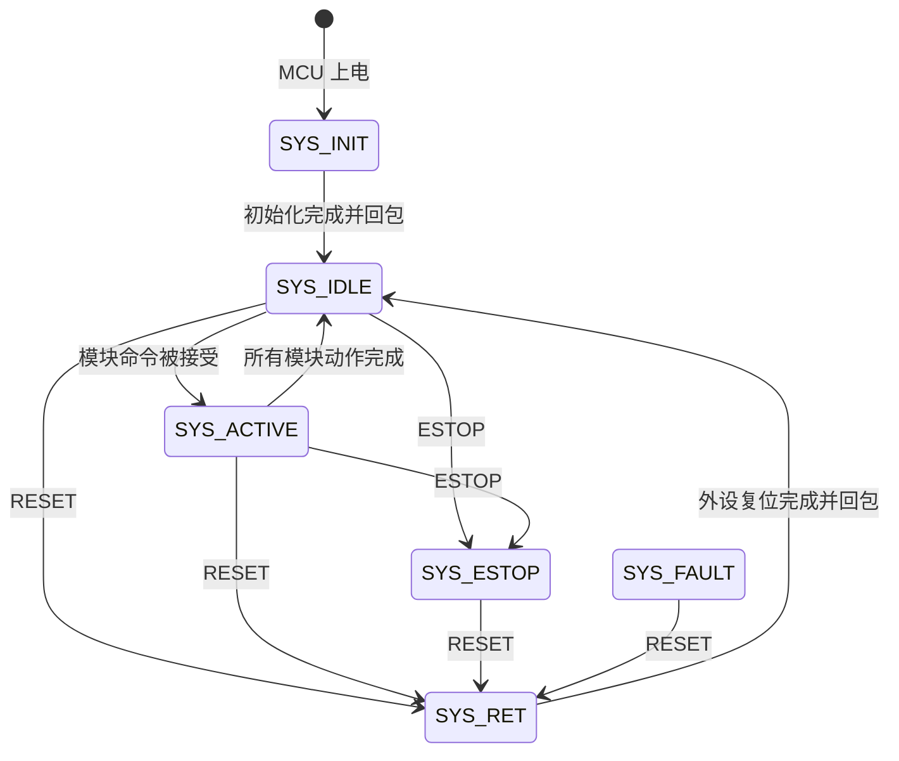

# 下位机简化状态机与统一协议方案

## 1. 本版设计原则

这一版按“能稳定调试、上位机好调用、后续能扩展”的原则收敛复杂度：

- MCU 上电后下位机自动初始化，不需要上位机发送初始化命令。
- 不设置 `BOOT` 命令，也不要求下位机等待上位机握手。
- 上位机发送握手包只是确认下位机在线，收到回包即可。
- 上位机可以发送 `RESET` 让下位机外设回到可用默认状态。
- 所有通信都使用统一二进制帧，不把文本作为协议内容。
- 每个模块只保留必要命令和必要状态，先保证工程能用。
- 后续新增外设时，只新增模块 ID、模块状态和模块命令，不推翻协议格式。

## 2. 系统状态机

系统状态只保留以下 6 个：

| 状态 | 含义 | 是否接收普通命令 |
| --- | --- | --- |
| `SYS_INIT` | MCU 上电后自动初始化外设 | 否 |
| `SYS_RET` | 外设复位/恢复中，由上位机 `RESET` 触发 | 否 |
| `SYS_IDLE` | 初始化完成，当前没有模块执行动作 | 是 |
| `SYS_ACTIVE` | 至少一个模块正在执行动作 | 是，按模块忙闲判断 |
| `SYS_ESTOP` | 急停/锁止状态 | 否，只接受 `RESET / GET_STATUS / HELLO` |
| `SYS_FAULT` | 故障状态，先预留 | 否，只接受 `RESET / GET_STATUS / HELLO` |

说明：

- `SYS_INIT` 是 MCU 启动后的自动流程，不需要上位机参与。
- `SYS_RET` 可以理解为“外设复位状态”，不是 MCU 复位。比如机械臂回默认姿态、底盘放松控制、气泵放下。
- 进入 `SYS_ESTOP` 后设备被锁止，上位机必须发送 `RESET`，下位机完成 `SYS_RET` 后才能恢复正常使用。
- `SYS_FAULT` 先只占位，后面有故障检测代码后再补细节。

推荐状态流转：



## 3. 上电初始化和握手

下位机上电流程：

```text
1. MCU 启动
2. 初始化时钟、GPIO、UART3、定时器、PWM、编码器等基础外设
3. 初始化底盘控制变量
4. 初始化机械臂，并移动到默认收敛姿态
5. 初始化气泵控制变量，默认关闭气泵
6. 系统状态从 SYS_INIT 转到 SYS_IDLE
7. 下位机主动发送 SYS_READY 事件包
```

注意：

- MCU 刚启动时 UART 可能还没准备好，所以不要求上位机参与启动流程。
- 如果下位机发送 `SYS_READY` 时上位机还没打开串口，丢了也没关系。
- 上位机后续发送 `HELLO` 或 `GET_STATUS`，下位机会返回当前系统状态。

上位机握手只用于确认通信正常：

```text
Host -> System: HELLO
System -> Host: ACK + 当前系统状态
```

握手不改变下位机状态，不触发初始化。

## 4. RESET 行为

上位机发送 `RESET` 后，下位机进入 `SYS_RET`，按模块执行恢复动作：

| 模块 | RESET 动作 |
| --- | --- |
| 底盘 | 停止上位机速度控制，目标速度清零，放松或回到默认可控状态 |
| 机械臂 | 回默认收敛姿态 |
| 气泵 | 停泵并执行放下流程 |
| IMU | 不复位，底盘控制使用当前位置作为相对基准 |

RESET 完成后：

```text
System -> Host: EVENT_SYS_RESET_DONE
System state = SYS_IDLE
```

如果 RESET 过程中某个模块忙或失败，先进入 `SYS_FAULT` 或保持 `SYS_RET`，并回 `EVENT_SYS_RESET_FAILED`。目前可以先只实现成功路径，故障码预留。

## 5. 底盘状态与命令

### 5.1 底盘状态

| 状态 | 含义 |
| --- | --- |
| `CHASSIS_IDLE` | 底盘空闲，速度为 0 |
| `CHASSIS_RUN` | 周期性速度控制中 |
| `CHASSIS_ROTATE` | 原地转向到目标角 |
| `CHASSIS_TRANSLATE` | 相对当前位置定点平移 |
| `CHASSIS_STOP` | 上位机控制超时后的普通停止 |
| `CHASSIS_BRAKE` | 主动刹车/急停相关 |
| `CHASSIS_BUSY` | 命令执行中，不接受冲突命令 |
| `CHASSIS_FAULT` | 故障预留 |

### 5.2 周期性控制要求

底盘的上位机速度控制必须是周期性的。

上位机周期发送：

```text
CHASSIS_RUN(vx, vy, wz)
```

下位机每次收到后刷新 `last_chassis_cmd_tick`。如果超过宏定义时间没有收到新的 `CHASSIS_RUN`：

```text
CHASSIS_CMD_TIMEOUT_MS
```

则底盘进入普通停止：

```text
target_vx = 0
target_vy = 0
target_wz = 0
chassis_state = CHASSIS_STOP
```

这里是“停止运动”，不是“刹停锁止”。也就是说它只是为了防止上位机掉线后车继续跑，不等同于急停或主动抱死刹车。

### 5.3 底盘命令

| 命令 | 载荷 | 说明 |
| --- | --- | --- |
| `CHASSIS_RUN` | `float vx, vy, wz` | 周期性速度控制，必须持续发送 |
| `CHASSIS_ROTATE_TO` | `float target_yaw, max_wz` | 旋转到相对/逻辑目标角，到达后回包 |
| `CHASSIS_TRANSLATE_REL` | `float dx, dy, speed` | 相对当前位置定向平移，到达后回包 |
| `CHASSIS_STOP` | 无 | 普通停止，速度清零，不锁止 |
| `CHASSIS_BRAKE` | 无 | 主动刹车或进入锁止策略 |
| `CHASSIS_GET_STATE` | 无 | 回复底盘当前状态 |

底盘动作完成时回包：

```text
EVENT_CHASSIS_DONE
```

底盘超时时回包可选：

```text
EVENT_CHASSIS_TIMEOUT_STOP
```

## 6. 机械臂状态与命令

### 6.1 机械臂状态

| 状态 | 含义 |
| --- | --- |
| `ARM_IDLE` | 空闲，当前位置已知 |
| `ARM_MOVING` | 正在执行目标动作 |
| `ARM_FOLDING` | 正在回默认收敛姿态 |
| `ARM_HOLD` | 停止并锁持 |
| `ARM_BUSY` | 忙，拒绝冲突命令 |
| `ARM_REJECTED` | 最近命令被拒绝 |
| `ARM_FAULT` | 故障预留 |

### 6.2 当前位置回复

机械臂必须支持上位机查询当前位置。

当前阶段没有舵机真实位置回读，所以回复的是逻辑位置：

```text
pose_source = LOGIC
```

后续如果增加舵机读位置或传感器反馈，可以改为：

```text
pose_source = REAL
```

建议机械臂状态回包包含：

```text
arm_state     u8
pose_source   u8   0=LOGIC, 1=REAL
x             float
y             float
z             float
dir           float
th0           float
th1           float
th2           float
th3           float
planner_busy  u8
phase_index   u8
phase_count   u8
```

### 6.3 机械臂命令

| 命令 | 载荷 | 说明 |
| --- | --- | --- |
| `ARM_TARGET_XYZ_DIR` | `float x, y, z, dir` | 发送吸盘末端三维坐标和竖直平面方向 |
| `ARM_FOLD_HOME` | 无 | 回默认收敛姿态 |
| `ARM_STOP_HOLD` | 无 | 停止当前规划并锁持舵机 |
| `ARM_GET_POSE` | 无 | 回复当前逻辑位置和关节角 |
| `ARM_GET_ANGLE` | 无 | 只回复当前关节角，也可并入 `ARM_GET_POSE` |

推荐简化：第一版只实现 `ARM_GET_POSE`，里面同时带位置和角度，后面不够再拆 `ARM_GET_ANGLE`。

机械臂命令回包规则：

```text
收到合法目标 -> ACK
目标不可达/禁入区/忙 -> NACK + 错误码
到达目标位置 -> EVENT_ARM_DONE
回收敛姿态完成 -> EVENT_ARM_FOLD_DONE
上位机查询位置 -> RESP_ARM_POSE
```

注意：`EVENT_ARM_DONE` 必须在机械臂到达目标后发送，上位机依赖这个事件进入下一步任务。

## 7. 气泵状态与命令

气泵协议不要暴露太多细节。占空比、频率阈值、检测次数等都由下位机宏定义或参数决定，上位机只关心“吸”和“放”。

### 7.1 气泵状态

| 状态 | 含义 |
| --- | --- |
| `PUMP_IDLE` | 空闲，气泵关闭，认为未吸附 |
| `PUMP_SUCKING` | 正在吸附 |
| `PUMP_SUCKED` | 已吸附 |
| `PUMP_RELEASING` | 正在放下，等待固定释放时间 |
| `PUMP_RELEASED` | 放下完成 |
| `PUMP_BUSY` | 忙，拒绝冲突命令 |
| `PUMP_FAULT` | 异常预留 |

### 7.2 放下逻辑

上位机发送 `PUMP_RELEASE` 后，下位机执行：

```text
1. 停止气泵 PWM
2. 关闭吸附检测
3. 进入 PUMP_RELEASING
4. 等待 PUMP_RELEASE_WAIT_MS
5. 认为工件已经释放
6. 进入 PUMP_RELEASED 或 PUMP_IDLE
7. 回包 EVENT_PUMP_RELEASE_DONE
```

`PUMP_RELEASE_WAIT_MS` 由实际调试确定，建议作为下位机宏定义保留。

### 7.3 气泵命令

| 命令 | 载荷 | 说明 |
| --- | --- | --- |
| `PUMP_SUCK` | 无 | 开始吸附，下位机自行决定占空比和检测阈值 |
| `PUMP_RELEASE` | 无 | 放下工件，等待固定释放时间后回包 |
| `PUMP_GET_STATE` | 无 | 回复当前气泵状态，可选 |

气泵回包规则：

```text
收到吸附命令 -> ACK
检测到吸附完成 -> EVENT_PUMP_SUCK_DONE
收到放下命令 -> ACK
固定释放时间结束 -> EVENT_PUMP_RELEASE_DONE
设备忙 -> NACK + BUSY
设备异常 -> NACK 或 EVENT_PUMP_FAULT
```

## 8. 模块忙闲规则

为了保证简单可用，第一版不做复杂命令队列。

建议每个模块只有一个当前命令：

```text
module_busy = 0/1
current_cmd
current_seq
```

规则：

- 模块空闲时接受新命令。
- 模块忙时，如果新命令会冲突，直接返回 `NACK_BUSY`。
- `ESTOP` 和 `RESET` 是系统级命令，优先级最高，可以打断所有模块。
- `GET_STATUS / GET_POSE / GET_STATE` 属于查询命令，不改变模块动作，忙的时候也可以回复。

## 9. 统一帧格式

建议第一版帧格式保持简单：

```text
HEAD1 HEAD2 VER SEQ MODULE CMD LEN PAYLOAD CHECK TAIL1 TAIL2
```

字段：

| 字段 | 长度 | 说明 |
| --- | --- | --- |
| `HEAD1` | 1 | 帧头 1，建议 `0xAA` |
| `HEAD2` | 1 | 帧头 2，建议 `0x55` |
| `VER` | 1 | 协议版本 |
| `SEQ` | 1 | 上位机命令序号，回包原样带回 |
| `MODULE` | 1 | 模块 ID |
| `CMD` | 1 | 命令字或响应字 |
| `LEN` | 1 | 载荷长度 |
| `PAYLOAD` | N | 小端载荷 |
| `CHECK` | 1 | 简单校验和，后续可换 CRC16 |
| `TAIL1` | 1 | 帧尾 1，建议 `0x0D` |
| `TAIL2` | 1 | 帧尾 2，建议 `0x0A` |

为了少改代码，第一版可以继续使用 1 字节校验和。等协议稳定后，如果现场串口干扰明显，再升级 CRC16。

所有 `float` 使用 IEEE754 小端格式。

## 10. 模块 ID

```text
0x01 SYSTEM
0x02 CHASSIS
0x03 ARM
0x04 PUMP
0x05 SENSOR      预留
0x06 AUX         预留
```

上位机发送命令时填目标模块。下位机回包时 `MODULE` 填实际回复模块。

## 11. 系统命令

| MODULE | CMD | 方向 | 说明 |
| --- | --- | --- | --- |
| `SYSTEM` | `HELLO` | Host -> MCU | 握手，只确认通信 |
| `SYSTEM` | `RESET` | Host -> MCU | 复位外设，进入 `SYS_RET` |
| `SYSTEM` | `ESTOP` | Host -> MCU | 进入 `SYS_ESTOP` |
| `SYSTEM` | `GET_STATUS` | Host -> MCU | 获取系统状态和模块状态 |

系统事件：

| 事件 | 方向 | 说明 |
| --- | --- | --- |
| `EVENT_SYS_READY` | MCU -> Host | 上电初始化完成 |
| `EVENT_SYS_RESET_DONE` | MCU -> Host | 外设复位完成 |
| `EVENT_SYS_ESTOP` | MCU -> Host | 已进入急停锁止 |
| `EVENT_SYS_FAULT` | MCU -> Host | 故障预留 |

## 12. 响应类型

统一使用以下响应：

| 响应 | 说明 |
| --- | --- |
| `RESP_ACK` | 命令收到并接受 |
| `RESP_NACK` | 命令被拒绝，载荷包含错误码 |
| `RESP_STATUS` | 系统或模块状态 |
| `RESP_EVENT` | 异步事件，例如到达目标、吸附完成 |
| `RESP_ARM_POSE` | 机械臂当前位置和角度 |

ACK/NACK 载荷建议：

```text
ref_seq   u8   对应上位机 SEQ
module    u8
cmd       u8
result    u8   0=OK，其它=错误码
state     u8   当前模块状态
```

事件载荷建议：

```text
ref_seq   u8   若事件对应某条命令，填该命令 SEQ；否则填 0
module    u8
event     u8
state     u8
result    u8
```

## 13. 错误码

第一版只保留常用错误码：

```text
0x00 OK
0x01 BAD_CMD
0x02 BAD_LEN
0x03 BAD_CHECK
0x04 BAD_STATE
0x05 BUSY
0x06 RANGE_LIMIT
0x07 FORBIDDEN_ZONE
0x08 TIMEOUT
0x09 DEVICE_ERROR
```

## 14. 上位机典型调用流程

### 14.1 启动后握手

```text
Host -> SYSTEM: HELLO
MCU  -> SYSTEM: RESP_ACK
MCU  -> SYSTEM: RESP_STATUS
```

如果上位机打开串口前错过了 `EVENT_SYS_READY`，直接 `HELLO` 或 `GET_STATUS` 即可知道下位机是否已初始化完成。

### 14.2 底盘周期运动

```text
Host -> CHASSIS: CHASSIS_RUN(vx, vy, wz)
Host -> CHASSIS: CHASSIS_RUN(vx, vy, wz)
Host -> CHASSIS: CHASSIS_RUN(vx, vy, wz)
```

如果上位机停止发送，超过 `CHASSIS_CMD_TIMEOUT_MS`：

```text
MCU: 底盘普通停止，非刹停
MCU -> Host: EVENT_CHASSIS_TIMEOUT_STOP 可选
```

### 14.3 机械臂目标

```text
Host -> ARM: ARM_TARGET_XYZ_DIR(x, y, z, dir)
MCU  -> ARM: RESP_ACK
MCU  -> ARM: EVENT_ARM_DONE
```

查询机械臂逻辑位置：

```text
Host -> ARM: ARM_GET_POSE
MCU  -> ARM: RESP_ARM_POSE(pose_source=LOGIC, x, y, z, dir, th0, th1, th2, th3)
```

### 14.4 气泵吸放

```text
Host -> PUMP: PUMP_SUCK
MCU  -> PUMP: RESP_ACK
MCU  -> PUMP: EVENT_PUMP_SUCK_DONE

Host -> PUMP: PUMP_RELEASE
MCU  -> PUMP: RESP_ACK
MCU  -> PUMP: EVENT_PUMP_RELEASE_DONE
```

### 14.5 急停后恢复

```text
Host -> SYSTEM: ESTOP
MCU  -> SYSTEM: EVENT_SYS_ESTOP

Host -> SYSTEM: RESET
MCU  -> SYSTEM: RESP_ACK
MCU  -> SYSTEM: EVENT_SYS_RESET_DONE
MCU 状态回到 SYS_IDLE
```

急停后不允许直接继续发送普通动作命令，必须先 `RESET`。

## 15. 后续实现建议

第一版实现时建议只新增很薄的一层系统调度：

```text
UnifiedProtocol.c
    负责收包、校验、发包

SystemManager.c
    保存 system_state
    保存各模块 state
    分发命令
    统一发送 ACK/NACK/EVENT/STATUS

Chassis / Arm / Pump
    保留现有业务代码
    提供简单的 start / stop / reset / get_state 接口
```

不要一开始就做复杂队列、TLV、动态注册、参数表。当前最重要的是让上位机能稳定调用：

- 知道下位机是否在线。
- 知道系统是否初始化完成。
- 能周期控制底盘，掉线自动停。
- 能让机械臂到点并收到完成回包。
- 能查询机械臂当前位置。
- 能让气泵吸附和放下并收到完成回包。
- 急停后必须 reset 才能继续使用。
